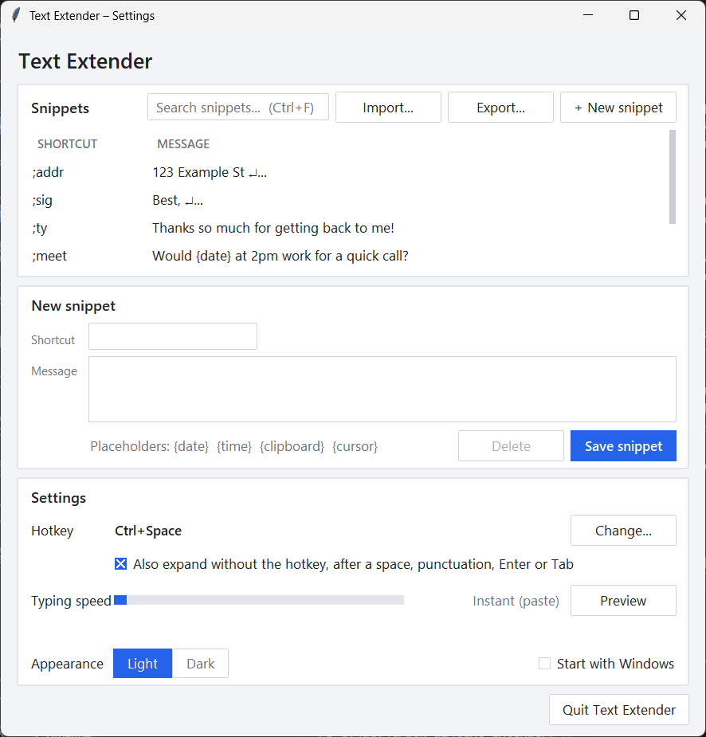

# Text Extender

[](https://github.com/LandonCosby/text-extender/actions/workflows/tests.yml)

A small Windows app for typing long text quickly. Type a shortcut such as `;addr`, press the hotkey (default **Ctrl+Space**), and the shortcut is replaced by its full message, in any app.

<!-- A GIF of an expansion (type ;addr, press Ctrl+Space, the address appears) goes here. -->


## Features

- **Works everywhere you type:** Notepad, browsers, Word, chat apps and so on.
- **Your choice of trigger:** press the hotkey, or have shortcuts expand on their own after a space, punctuation, Enter or Tab.
- **Placeholders** for today's date, the time, the clipboard's text, and where the cursor ends up.
- **Instant or typed out:** messages are pasted instantly, with your clipboard put back afterwards, or typed at a speed you choose.
- **A settings window** with search, light and dark modes, a hotkey recorder, and import and export of snippets.
- **Stays out of the way** in the system tray, with Pause / Resume, and can start with Windows.

## Download

Get `TextExtender.exe` from the [latest release](https://github.com/LandonCosby/text-extender/releases/latest) and run it. Nothing needs installing.

The `.exe` isn't signed, so the first time you run it, Windows may show **"Windows protected your PC"**. Click **More info**, then **Run anyway**. If you'd rather not, you can [run it from the source](#run-from-the-source) instead.

## Using it

It runs in the **system tray** (the blue "T…" icon; on Windows 11 it may be under the `^` arrow), and the settings window opens when it starts. Right-click the icon for:
- **Open settings** (or double-click the icon): add, edit, delete and search snippets (Ctrl+F), import and export them, change the hotkey, turn on automatic expansion, set the typing speed, switch between light and dark mode, and start it with Windows. Changes are saved and used straight away. Closing the window keeps the app running; the **Quit Text Extender** button ends it.
- **Pause / Resume**: the icon turns grey while paused.
- **Quit**

Only one copy runs at a time: starting it again just brings up the settings window.

To try it, open any text box, type `;te`, and press **Ctrl+Space**.

- A shortcut must come after a space or a new line (`hi ;te` works, `hi;te` doesn't), and capitals matter.
- It can't type into programs running as administrator; Windows blocks that.

### Automatic expansion

Tick **Also expand without the hotkey** in Settings, and a shortcut also expands as soon as you type a space, punctuation, Enter or Tab after it. That character is kept after the message: `;te,` becomes `Text Extender is working!,`. Enter and Tab are pressed after the message, so Enter still sends a chat message. The hotkey keeps working too.

If one shortcut is the start of another (`;a` and `;a.b`), typing `.` after `;a` waits, in case you're typing `;a.b`.

### Placeholders

Messages can contain:

| Placeholder | Becomes |
|---|---|
| `{date}` | today's date, in your Windows short date format |
| `{time}` | the time now, in your Windows short time format |
| `{clipboard}` | the text on the clipboard (nothing if it holds an image or files) |
| `{cursor}` | where the cursor is left after expanding, instead of at the end |

For example `Dear {cursor},\n\nThanks,\nYour Name` leaves the cursor after "Dear ". Other text in braces is left as it is.

### Importing and exporting

**Export…** saves all your snippets to a `.json` file, for a backup or to move them to another PC. **Import…** adds the snippets from such a file (or from a copy of `config.json`). If a shortcut you already have comes with a different message, it asks whether to replace yours.

## Privacy

Text Extender has to watch the keyboard to spot shortcuts, so here's exactly what it does with that:
- It keeps only the **last 50 characters** you typed, in memory, and forgets them whenever you click, switch windows or move the cursor. Nothing you type is saved or logged.
- It **never connects to the internet**.
- Your snippets are stored only on your PC, in `%APPDATA%\TextExtender\config.json`.

## Settings file

`%APPDATA%\TextExtender\config.json`, which you can also edit by hand while the app is closed:

```json
{
  "hotkey": "<ctrl>+<space>",
  "char_delay_ms": 0,
  "theme": "light",
  "auto_expand": false,
  "snippets": {
    ";te": "Text Extender is working!",
    ";sig": "Best,\nYour Name"
  }
}
```

- `char_delay_ms`: 0 pastes instantly; 1–200 types one character at a time with that many milliseconds between (never faster than 25 ms, which is about as fast as apps reliably keep up with).
- `theme`: `"light"` or `"dark"`.
- `auto_expand`: `true` to also expand after a space, punctuation, Enter or Tab.

If something goes wrong, errors are written to `textextender.log` in the same folder.

## How it works

- **Spotting the hotkey:** a low-level Windows keyboard hook (through [pynput](https://github.com/moses-palmer/pynput)) sees every key before any app does. The hotkey is recognised from raw key codes and **blocked**, so Ctrl+Space never reaches the app you're typing in (in VS Code, for example, it won't open the suggestion list).
- **Knowing what was typed:** the other keys are let through and added to a short buffer, which is cleared by anything that might move the cursor: arrow keys, Enter, mouse clicks, switching windows. The longest shortcut the buffer ends with wins, so `;addr2` beats `;addr`.
- **Replacing it:** the shortcut is erased with Backspaces, then the message is either pasted (the clipboard is saved first and put back after) or typed with Windows' `SendInput` as Unicode characters, so capitals, accents and emoji arrive intact. Testing in real apps showed they drop simulated keys sent faster than about 25 ms apart, so it never types faster than that.
- **Not tripping over itself:** keys the app presses are marked by Windows as injected, and the hook ignores them.

## Run from the source

Needs Python 3.10 or later, on Windows.

```
python -m pip install -r requirements.txt
pythonw main.py
```

(`pythonw` starts it without a terminal window; `python main.py` works too.)

## Development

```
python -m pip install -r requirements-dev.txt
python -m pytest tests          # the tests
python tools/build_exe.py       # builds dist/TextExtender.exe
```

To try it in real Notepad (it takes over the keyboard for about 30 seconds), and for a by-hand checklist for other apps, see [TESTING.md](TESTING.md). Changes are listed in [CHANGELOG.md](CHANGELOG.md).

## License

[MIT](LICENSE)
